# Phase 1–4 entity relationships

Columns shown are key fields, not a complete schema. The migration DDL is authoritative. `complaints`, `complaint_events`, and `audit_logs` are monthly range-partitioned by `created_at`, `occurred_at`, and `created_at`, respectively. Complaint children carry composite `(complaint_id, complaint_created_at)` FKs; duplicate candidates carry both immutable complaint keys. Integration payloads are encrypted in `integration_jobs`; retry exhaustion creates an `integration_dead_letters` record.

```mermaid
erDiagram
    CUSTOMERS ||--o{ POLICIES : holds
    CUSTOMERS ||--o{ COMPLAINTS : opens
    INSURANCE_COMPANIES ||--o{ POLICIES : issues
    INSURANCE_COMPANIES ||--o{ COMPLAINTS : handles
    POLICIES |o--o{ COMPLAINTS : referenced_by
    COMPLAINT_KEYS ||--|| COMPLAINTS : locates
    CATEGORIES |o--o{ COMPLAINTS : classifies
    TEAMS |o--o{ COMPLAINTS : owns
    STAFF_USERS |o--o{ COMPLAINTS : assigned
    COMPLAINTS ||--o{ COMPLAINT_EVENTS : timeline
    COMPLAINTS ||--o{ COMPLAINT_MESSAGES : conversation
    COMPLAINT_MESSAGES |o--o{ ATTACHMENTS : carries
    COMPLAINTS ||--o{ ATTACHMENTS : owns
    COMPLAINTS |o--o{ NOTIFICATIONS : relates_to
    COMPLAINTS ||--o{ CALL_LOGS : call_history
    COMPLAINTS ||--o{ AI_INSIGHTS : ai_suggestions
    COMPLAINTS |o--o{ INTEGRATION_JOBS : processes
    STAFF_USERS |o--o{ INTEGRATION_JOBS : initiates
    INTEGRATIONS_CONFIG |o--o{ INTEGRATION_JOBS : configures
    WEBHOOKS |o--o{ INTEGRATION_JOBS : delivers
    INTEGRATION_JOBS ||--o| INTEGRATION_DEAD_LETTERS : dead_letters
    COMPLAINTS ||--o{ DUPLICATE_CANDIDATES : first_candidate
    COMPLAINTS ||--o{ DUPLICATE_CANDIDATES : second_candidate
    COMPLAINTS ||--o{ CSAT_RESPONSES : customer_feedback
    COMPLAINTS |o--o{ AUDIT_LOGS : audited
    STAFF_USERS ||--o{ USER_ROLES : has
    ROLES ||--o{ USER_ROLES : assigned
    ROLES ||--o{ ROLE_PERMISSIONS : grants
    PERMISSIONS ||--o{ ROLE_PERMISSIONS : member
    STAFF_USERS ||--o{ USER_PERMISSION_OVERRIDES : overrides
    STAFF_USERS ||--o{ USER_COMPANY_SCOPE : company_grants
    INSURANCE_COMPANIES |o--o{ USER_COMPANY_SCOPE : in_scope
    STAFF_USERS ||--o{ USER_INSURANCE_TYPE_SCOPE : type_restrictions
    STAFF_USERS ||--|| USER_OWNERSHIP_LEVEL : ownership
    STAFF_USERS ||--o{ TEAM_MEMBERS : member
    TEAMS ||--o{ TEAM_MEMBERS : members
    STAFF_USERS ||--o{ ACCESS_CHANGE_LOG : target
    STAFF_USERS ||--o{ AUTH_SESSIONS : signs_in
    CUSTOMERS ||--o{ AUTH_SESSIONS : signs_in
    CUSTOMERS ||--o{ CONSENT_RECORDS : consents
    CUSTOMERS ||--o{ PRIVACY_REQUESTS : requests
    STAFF_USERS ||--o{ PRIVACY_REQUESTS : handles
    STAFF_USERS ||--o{ STAFF_INVITATIONS : receives
    STAFF_USERS |o--o{ SECURITY_SETTINGS : updates
    CUSTOMERS ||--o{ COMPLAINT_IDEMPOTENCY : submits
    COMPLAINTS ||--o{ COMPLAINT_IDEMPOTENCY : deduplicated
    COMPLAINTS ||--o{ ATTACHMENT_UPLOADS : reservations
    ATTACHMENT_UPLOADS |o--o| ATTACHMENTS : finalizes
    COMPLAINTS ||--o{ NOTIFICATION_OUTBOX : queues
    STAFF_USERS ||--o{ SAVED_FILTERS : owns
    STAFF_USERS ||--o{ REPORT_SCHEDULES : schedules
    STAFF_USERS ||--o{ EXPORT_JOBS : requests
    EXPORT_JOBS ||--o{ EXPORT_JOB_ROWS : authorizes
    REPORT_SCHEDULES ||--o{ REPORT_RUNS : executes
    COMPLAINTS ||--o{ EXPORT_JOB_ROWS : manifests
    INSURANCE_COMPANIES |o--o{ ASSIGNMENT_RULES : routes
    TEAMS |o--o{ ASSIGNMENT_RULES : targets
    INSURANCE_COMPANIES |o--o{ SLA_RULES : customizes
    INSURANCE_COMPANIES |o--o{ INTEGRATIONS_CONFIG : configures
    INSURANCE_COMPANIES |o--o{ WEBHOOKS : subscribes
    STAFF_USERS ||--o{ API_KEYS : owns
    STAFF_USERS |o--o{ CANNED_REPLIES : creates

    CUSTOMERS {
      uuid id PK
      bytea national_id_ciphertext
      bytea national_id_blind_index UK
      text mobile
    }
    INSURANCE_COMPANIES {
      uuid id PK
      text slug UK
      string contact_emails
    }
    POLICIES {
      uuid id PK
      uuid customer_id FK
      uuid company_id FK
      text policy_number
      string insurance_type
    }
    COMPLAINT_KEYS {
      uuid id PK
      timestamptz created_at
      text ticket_no UK
    }
    COMPLAINTS {
      uuid id PK
      timestamptz created_at PK
      text ticket_no
      uuid customer_id FK
      uuid company_id FK
      string insurance_type
      string status
      uuid assigned_agent_id FK
      uuid team_id FK
      tsvector search_vector
    }
    COMPLAINT_EVENTS {
      uuid id PK
      timestamptz occurred_at PK
      uuid complaint_id FK
      timestamptz complaint_created_at FK
    }
    COMPLAINT_MESSAGES {
      uuid id PK
      uuid complaint_id FK
      timestamptz complaint_created_at FK
      string visibility
    }
    ATTACHMENTS {
      uuid id PK
      uuid complaint_id FK
      uuid message_id FK
      bytea content
      text checksum_sha256
      string scan_status
    }
    NOTIFICATIONS {
      uuid id PK
    }
    CALL_LOGS {
      uuid id PK
    }
    AUDIT_LOGS {
      uuid id PK
      timestamptz created_at PK
      uuid complaint_id FK
    }
    STAFF_USERS {
      uuid id PK
      text email UK
      string status
      integer token_version
    }
    ROLES {
      uuid id PK
    }
    PERMISSIONS {
      text code PK
    }
    ROLE_PERMISSIONS {
      uuid role_id FK
    }
    USER_ROLES {
      uuid user_id FK
    }
    USER_PERMISSION_OVERRIDES {
      uuid user_id FK
    }
    USER_COMPANY_SCOPE {
      uuid user_id FK
    }
    USER_INSURANCE_TYPE_SCOPE {
      uuid user_id FK
    }
    USER_OWNERSHIP_LEVEL {
      uuid user_id PK
    }
    TEAMS {
      uuid id PK
    }
    TEAM_MEMBERS {
      uuid team_id FK
    }
    ACCESS_CHANGE_LOG {
      uuid id PK
    }
    CATEGORIES {
      uuid id PK
    }
    SLA_RULES {
      uuid id PK
    }
    CANNED_REPLIES {
      uuid id PK
    }
    SAVED_FILTERS {
      uuid id PK
    }
    INTEGRATIONS_CONFIG {
      uuid id PK
    }
    WEBHOOKS {
      uuid id PK
    }
    API_KEYS {
      uuid id PK
    }
    AI_INSIGHTS {
      uuid id PK
      uuid complaint_id FK
      bytea payload_ciphertext
    }
    INTEGRATION_JOBS {
      uuid id PK
      text job_kind
      text provider
      bytea payload_ciphertext
      bytea idempotency_digest UK
      uuid sender_staff_id FK
      text state
      integer attempts
    }
    INTEGRATION_DEAD_LETTERS {
      uuid job_id PK, FK
      text error_code
      integer attempts
      timestamptz replayed_at
    }
    DUPLICATE_CANDIDATES {
      uuid id PK
      uuid first_complaint_id FK
      uuid second_complaint_id FK
    }
    CSAT_RESPONSES {
      uuid id PK
      uuid complaint_id FK
      integer score
    }
    ASSIGNMENT_RULES {
      uuid id PK
      uuid company_id FK
      uuid target_team_id FK
    }
    SECURITY_SETTINGS {
      boolean singleton PK
      boolean staff_2fa_required
    }
    CONSENT_RECORDS {
      uuid id PK
      uuid customer_id FK
      text purpose
      boolean granted
      text policy_version
      timestamptz created_at
    }
    PRIVACY_REQUESTS {
      uuid id PK
      uuid customer_id FK
      text kind
      text status
      uuid handled_by FK
      timestamptz due_at
    }
    AUTH_SESSIONS {
      uuid id PK
      uuid subject_id
      bytea refresh_digest UK
      uuid family_id
    }
    STAFF_INVITATIONS {
      uuid id PK
      uuid staff_user_id FK
      bytea token_digest UK
    }
    COMPLAINT_IDEMPOTENCY {
      uuid customer_id PK
      bytea key_digest PK
      uuid complaint_id FK
    }
    ATTACHMENT_UPLOADS {
      uuid id PK
      uuid complaint_id FK
      string status
      timestamptz expires_at
    }
    NOTIFICATION_OUTBOX {
      uuid id PK
      uuid complaint_id FK
      string state
    }
    INSURER_OUTBOX {
      uuid id PK
      uuid complaint_id FK
      string state
    }
    REPORT_SCHEDULES {
      uuid id PK
      uuid owner_staff_id FK
    }
    EXPORT_JOBS {
      uuid id PK
      uuid owner_staff_id FK
    }
    EXPORT_JOB_ROWS {
      uuid job_id PK
      uuid complaint_id PK
      timestamptz complaint_created_at FK
    }
    REPORT_RUNS {
      uuid id PK
      uuid schedule_id FK
      uuid owner_staff_id FK
      text state
    }
    ANALYTICS_ROLLUP_STATE {
      boolean id PK
      timestamptz last_success_at
    }
```

